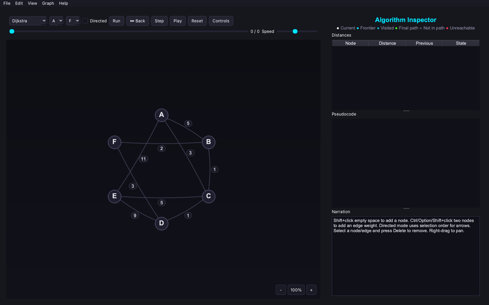
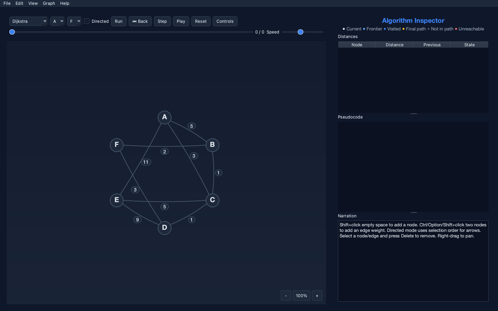
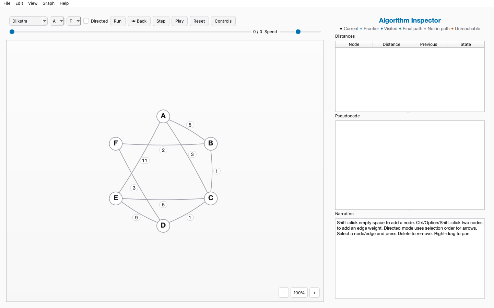
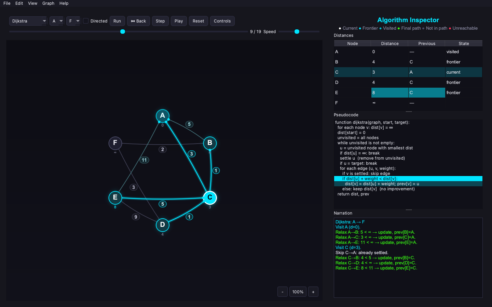

# Dijkstra Path Visualizer

[](https://python.org)
[](https://pypi.org/project/PyQt6/)
[](LICENSE)
[](https://en.wikipedia.org/wiki/Dijkstra%27s_algorithm)
[](https://en.wikipedia.org/wiki/Breadth-first_search)
[](https://en.wikipedia.org/wiki/Bellman%E2%80%93Ford_algorithm)
[](https://en.wikipedia.org/wiki/A*_search_algorithm)
[]()
[]()

An interactive teaching tool for shortest-path algorithms. Build a weighted graph on the canvas, pick an
algorithm, and watch it run **step by step**: play, pause, step forward or back, and scrub the timeline to
any point. A live inspector shows the distance table, the algorithm's pseudocode with the current line
highlighted, and a plain-English narration of every visit, relaxation, and skip. Four algorithms
(Dijkstra, BFS, Bellman-Ford, A\*) and live-editable themes make the same graph easy to compare and easy to
read.

## Screenshots

| Neon Dark | Midnight | Paper Light |
|-----------|----------|-------------|
|  |  |  |



## Features

### Step / scrub playback
- **Transport controls**: Run, Step, Step Back, Play/Pause, and Reset.
- **Timeline scrubber**: drag to jump to any step; the whole view re-derives that frame exactly.
- **Adjustable speed**: a slider sets the autoplay interval.
- **Keyboard shortcuts**: Space to play/pause, Left/Right to step, Home/End to jump to the first/last step.

### Educational inspector
- **Distance table** that updates live as nodes are settled and edges relaxed.
- **Pseudocode panel** that highlights the exact line(s) responsible for the current step.
- **Narration log** describing each step in words (visit, relax, skip, target found / unreachable), plus a
  post-run summary (path, cost, visits, relaxations, skips, comparisons) and a cross-algorithm comparison
  when you re-run the same start/target with a different algorithm.
- **Color legend** for current / visited / final-path / not-in-path / unreachable states.

### Algorithm suite
- **Dijkstra**: least-total-weight shortest path over non-negative weights.
- **BFS**: fewest-*hops* path that ignores weights, so you can contrast "fewest edges" against Dijkstra's
  "least total weight" on the same graph.
- **Bellman-Ford**: handles negative edge weights and **detects negative cycles**, reporting when no
  shortest path exists.
- **A\***: Dijkstra guided by a spatial (Euclidean) heuristic scaled to stay admissible (see below).

### Graph editing
- Add nodes, connect them with weighted edges, rename nodes, edit weights, drag to reposition, select
  multiple nodes for group moves, and delete, all directly on the canvas.
- **Undirected** or **directed** mode (directed uses selection order for arrow direction; add reverse edges
  for two-way paths with different weights).
- **Open / Save / Save As** graphs as JSON (node positions, labels, weights, and directed/undirected mode
  are preserved).
- **Undo / redo** for every edit: add/delete/rename, weight changes, node moves (one step per drag),
  layout application, and the directed toggle via Edit -> Undo / Redo (Ctrl+Z / Ctrl+Shift+Z).

### Graph tooling
- **Generate Random...**: seeded random graphs (2-50 nodes, edge density, weight range, directed,
  connected); the resolved seed is echoed back so every generation is reproducible.
- **Layouts**: Circle, Grid, and Spring (deterministic), animated into place from the Graph menu.
- **Snap to Grid**: optional grid drawing and node snapping, with editable grid spacing.
- **Movable splitters**: resize the controls, graph canvas, and inspector panels to fit your workflow.
- **Canvas navigation**: drag empty canvas, right-drag, or middle-drag to pan; use the mouse wheel or
  overlay buttons to zoom.
- **New / New Demo Graph / Examples**: start fresh, reload the classic A-F demo, or open the bundled
  example graphs (source checkout only).
- **Export**: save the canvas as a **PNG** (2x scale) or **SVG** from the File menu.
- **Recent files**: the File menu keeps the last eight graphs you opened or saved.

### Themes
- **Neon Dark**, **Midnight**, and **Paper Light**: switch live from the View -> Theme menu; your choice is
  persisted between sessions.
- **Paper Light** uses the **Okabe-Ito** colorblind-safe palette.
- **Theme Studio**: open View -> Edit Theme... to tune canvas colors, node states, edge states, Qt borders,
  radii, padding, sliders, scrollbars, splitter handles, and animation colors.
- **Custom themes**: save edited themes, import/export theme JSON, paste JSON, import/paste Qt stylesheet
  QSS, copy generated QSS, and delete saved custom themes from View -> Delete Custom Theme... or inside the editor.
- **QSS import flow**: pasted QSS is saved as a stylesheet layer. Press **Import pasted QSS** when you want
  to copy stylesheet colors into editable theme fields; later manual color edits stay in charge when saved.
- **Animation controls**: choose the relax effect, final reveal style, motion scale, travel color, impact
  color, badge flash color, and whether node rings or badges flash when an animation hits.

## Installation

**Requirements:** Python >= 3.10. The only runtime dependency is **PyQt6** (`>= 6.4.0`).

```bash
python -m venv .venv
source .venv/bin/activate          # Windows: .venv\Scripts\activate
pip install -e ".[dev]"            # runtime + test tooling
```

For a runtime-only install, use `pip install -e .` or `pip install -r requirements.txt`.

## Running

```bash
python main.py
```

Equivalent entry points once installed:

```bash
dijkstra-ui                # console script (see pyproject.toml [project.scripts])
python -m dijkstra_dashboard
```

### Tests

```bash
pytest
```

## Controls

Editing gestures and keyboard shortcuts (the in-app **Help → Controls** dialog lists the same set):

| Action | Input |
|--------|-------|
| Add node | Shift + click empty canvas |
| Add / update edge | Ctrl / Option / Shift + click two nodes, then enter a weight |
| Rename node | Double-click a node |
| Edit edge weight | Double-click an edge or its weight chip |
| Move node | Drag the node |
| Move multiple nodes | Cmd-click nodes to select them, then drag any selected node |
| Remove node / edge | Select it and press Delete (or Backspace) |
| Pan the view | Drag empty canvas, right-drag, or middle-drag |
| Zoom | Mouse wheel (anchored under the cursor), or the +/- / 100% overlay buttons |
| Zoom / fit menu | View -> Zoom In / Zoom Out / Reset Zoom / Fit to Graph |
| Play / Pause | Space |
| Step forward / back | Right / Left arrow |
| Jump to first / last step | Home / End |
| Undo / Redo | Ctrl+Z / Ctrl+Shift+Z (Cmd on macOS) |
| Generate a random graph | Graph -> Generate Random... |
| Apply a layout | Graph -> Layout -> Circle / Grid / Spring |
| Toggle grid snapping | Graph -> Snap to Grid / Grid Size... |
| Edit or delete themes | View -> Edit Theme... / Delete Custom Theme... |
| Export the canvas | File -> Export as PNG... / Export as SVG... |

Transport shortcuts use a window-level binding with a focus guard: they are ignored while an editable widget
(a combo box, slider, or text field) holds keyboard focus, so typing a weight or picking an algorithm never
triggers playback.

## Algorithms

**Dijkstra**: Repeatedly settles the unvisited node with the smallest tentative distance, then relaxes its
outgoing edges. Requires non-negative weights (negative weights raise an error). With a target set, it stops
as soon as the target is settled.

**BFS (breadth-first search)**: Explores in FIFO order, counting *hops* rather than summing weights, so it
returns the path with the fewest edges. Running BFS and Dijkstra on the same weighted graph makes the
difference between "fewest edges" and "least total weight" concrete.

**Bellman-Ford**: Relaxes every edge over up to `|V| - 1` passes (undirected edges are relaxed in both
directions), stopping early once a pass makes no changes. A final detection pass checks whether any edge can
still be relaxed; if so, a **negative cycle** exists and the run reports that no shortest paths are defined -
the teaching point that Dijkstra cannot handle negative weights but Bellman-Ford can, up to a cycle.

**A\***: Dijkstra ordered by `f = g + h`, where `h(n)` is the straight-line (Euclidean) distance from `n`
to the target scaled by a constant `c`. That constant is the minimum ratio of edge weight to edge length
across the graph, so every edge costs at least `c` times its Euclidean length. Because the straight-line
distance scaled by `c` is therefore never more than the true remaining cost, the heuristic is admissible
(and consistent), which guarantees A\* still returns an optimal path - it just settles fewer nodes by
steering toward the target. A\* requires a target.

## Architecture

- **Trace-first core.** Each algorithm's `iter_steps` yields a stream of typed step events
  (`visit` / `relax` / `skip` / `final`); a small runner folds that stream into distances, predecessors,
  reconstructed paths, and visit order (`runner.apply_steps` / `result_from_steps`).
- **Qt-free core, thin UI.** `core/` (graph model, the four algorithms, the runner, the sample and
  random-graph generators) imports no Qt and is fully unit-tested headlessly; the narration formatters
  (`ui/narration.py`) are likewise pure functions with pinned goldens; `ui/` holds the PyQt6 widgets.
- **Snapshot undo/redo.** Every mutation captures a whole-graph before/after snapshot pair onto a
  `QUndoStack`; undo restores through the same `set_graph` pipeline the file loaders use.
- **Refold scrubbing.** `PlaybackController` owns the trace and replay state. Seeking or stepping back
  re-folds `steps[:index]` from scratch, so every frame, whether forward, backward, or a timeline jump, is
  reconstructed deterministically, and the graph view stays a pure renderer of the emitted `RenderFrame`.
- **Theme engine.** A `ThemeManager` holds three immutable `Theme` dataclasses with per-state node/edge
  style maps; it generates the Qt palette and stylesheet from color tokens, emits `theme_changed`, persists
  the selection via a small JSON config, and saves custom user themes as JSON files.
- **Pseudocode / step-line maps.** Every algorithm carries its own `pseudocode` lines and a `step_line_map`
  from `(step kind, reason)` to the pseudocode line numbers to highlight, which is what lets the inspector
  point at the code responsible for each step.
- **Teaching twin.** `lessons/shortest_path.py` is a compact, heavily commented Dijkstra that reads like the
  textbook version; the UI's Dijkstra pseudocode is derived from it.

## License

Released under the [MIT License](LICENSE). Copyright (c) 2025 Justin Guida.
